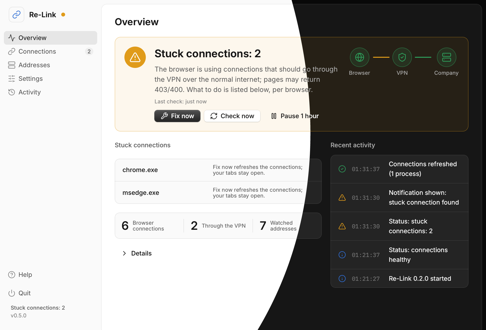
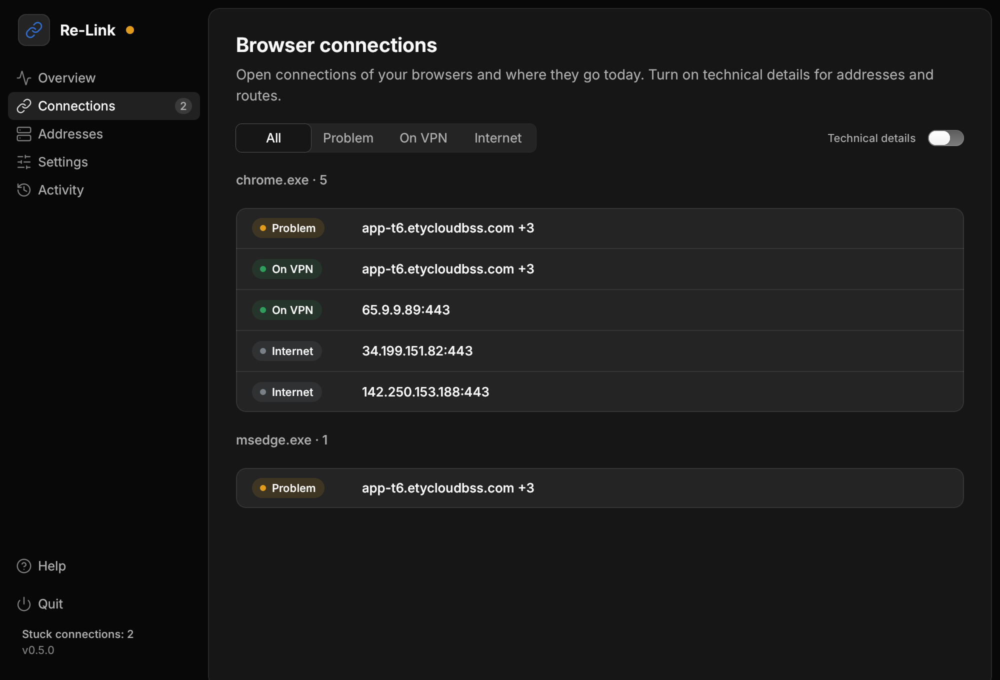
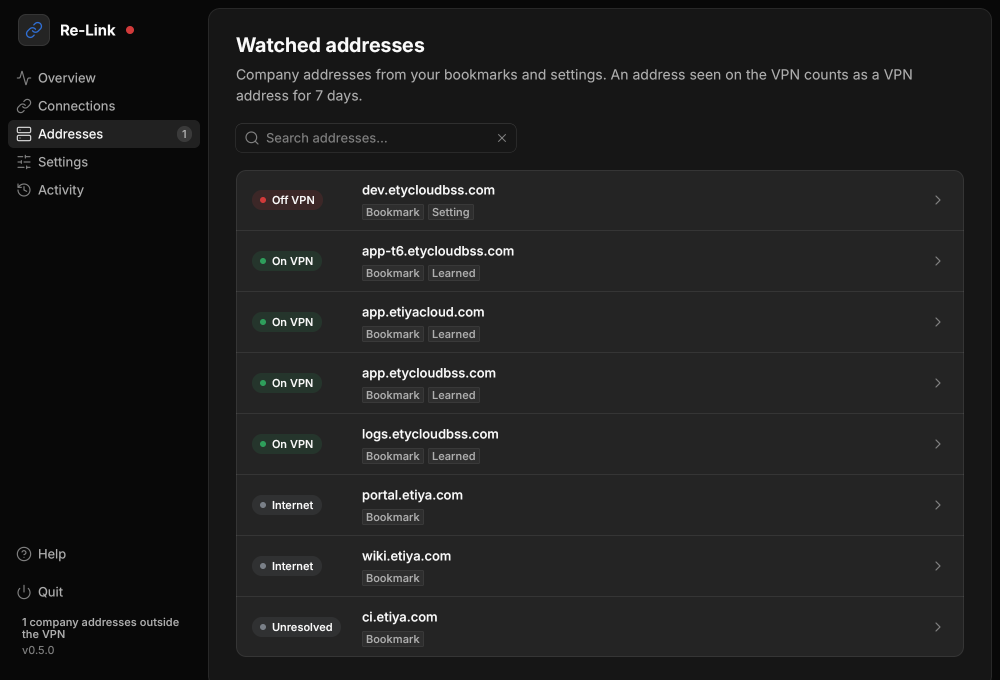
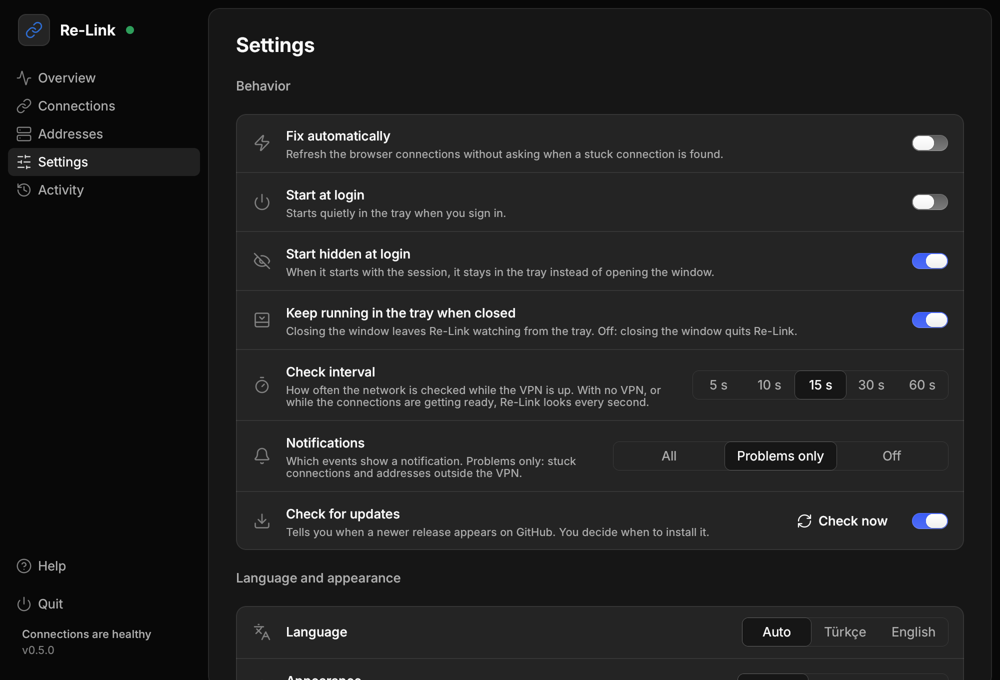
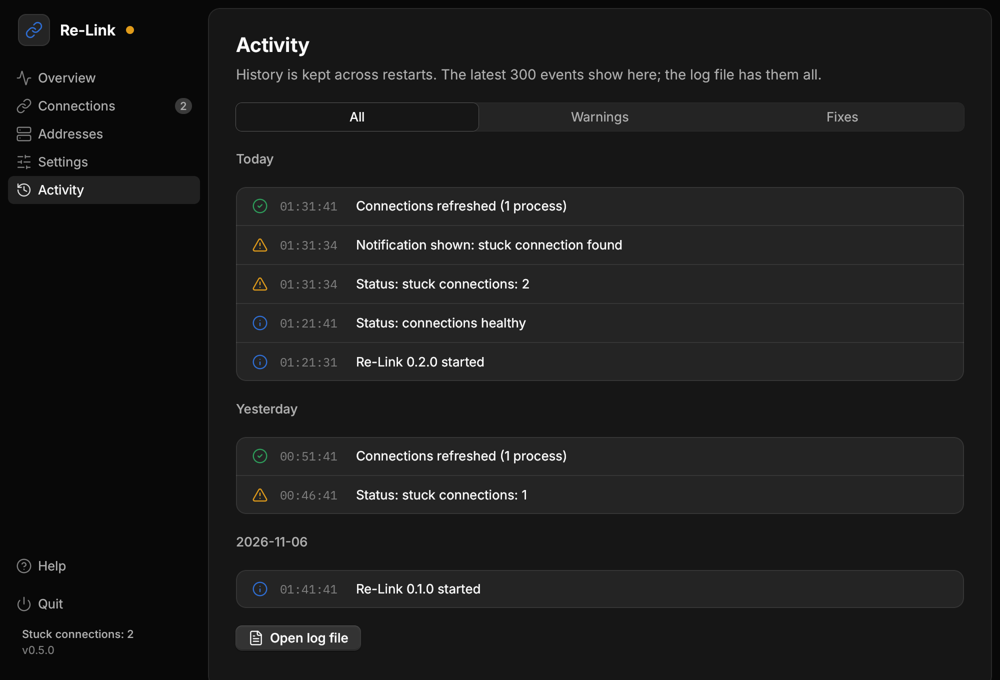

<p align="center"></p>

# Re-Link

A tray app for Windows and Linux that keeps browsers working while a FortiClient
VPN split tunnel is on.

Internal pages in Chrome, Edge and Firefox sometimes return **403/400** while the
VPN is connected. Reconnecting doesn't help; only restarting the browser does.
Re-Link finds those stuck connections quietly in the tray and clears them without
closing the browser.

## Screenshots

<p align="center"></p>

<p align="center">


</p>

<p align="center">


</p>

## What it does

FortiClient's split tunnel routes only specific hosts through the VPN. A browser
connection opened before such a route existed stays on the home network, and the
site keeps answering 403. Re-Link watches the browsers' open connections and
restarts Chromium's **Network Service** when one is stuck: **tabs stay open**, only
the stale connections and the DNS cache are dropped. No host list is needed.

- Checks every 15 seconds (every second while the VPN starts) and notifies you,
  or fixes on its own with *Fix automatically*.
- Watches the company hosts in your bookmarks and in `relink.json`; when a route
  is missing it asks you to reconnect the VPN and tidies up afterwards.
- No administrator rights, PowerShell or .NET. The installer is per user.
- Closing the window leaves Re-Link in the tray.

The manual equivalent is **Shift+Esc** → *Network Service* → *End process*.
Firefox on Windows keeps its sockets in the main process: Re-Link reports the
problem, and you restart the browser (on Linux the helper closes the sockets itself).

While the Network Service restarts, downloads and WebSocket connections drop, and
some sites may ask you to sign in again.

## Download

From the [latest release](https://github.com/denizguzel/relink/releases/latest):

| File | For |
|---|---|
| `relink-<version>-windows-x64-setup.exe` | Windows installer, per user, no administrator rights. |
| `relink-<version>-windows-x64-portable.zip` | Windows without installing; settings stay beside the program. |
| `relink-<version>-linux-x86_64.tar.gz` | Linux (Ubuntu 20.04 or newer), with the root helper and `install-linux.sh`. |

Re-Link checks for new releases and offers **Update and restart**, which downloads
the file, verifies its checksum and replaces the running program. The check can be
turned off in Settings. Every release ships `SHA256SUMS` and build provenance
attestations. Windows SmartScreen may warn the first time you run an unsigned
download; in-app updates are not affected.

## Using it

The tray icon shows the state: green when healthy, grey without a VPN, orange for
a stuck connection, red for a missing route. Click it for **Fix now**, **Check
now**, pause and quit; the window holds the settings, the browser connections, the
watched hosts and the activity log. To try the fix, turn the VPN off and on again
while Re-Link runs.

Command line: `relink --check` (read-only diagnosis), `relink --dump` (a bug
report), `relink --fix`, `relink --version`.

## Settings

`relink.json` lives in `%APPDATA%\Re-Link` (Linux: `~/.config/relink`); the
portable zip keeps it beside the program. It is created on first run with every
option, and edits apply without a restart. The window covers the common ones: fix
automatically, start with Windows, check interval, notifications, language, theme,
watched hosts and the company domains found in your bookmarks.

## Linux

Same app and window. The optional root helper also adds missing VPN routes itself
and closes stuck sockets one by one, which works for Firefox too:

```sh
tar xzf relink-<version>-linux-x86_64.tar.gz && cd relink-<version>-linux-x86_64
sudo ./install-linux.sh   # helper in /usr/local/bin, rule in /etc/sudoers.d/relink
./relink
```

The updater never replaces the helper; when a release changes it, rerun
`install-linux.sh`. Remove it with
`sudo rm /usr/local/bin/relink-helper /etc/sudoers.d/relink`.

## Development

Rust + [Rune](https://github.com/anomalyco/rune) (the UI toolkit Hex uses). In WSL:

```sh
make test      # unit tests
make lint      # fmt + clippy, what CI runs
make snaps     # render every screen headless to target/snaps
make build     # Windows exe (cargo xwin)
make linux     # Linux files (glibc 2.31)
make desktop   # build and replace the portable copy on the Windows Desktop
```

Needs `rustup target add x86_64-pc-windows-msvc`, `cargo-xwin`, `cargo-zigbuild`,
`clang` and `lld`. Texts live in `locales/app/{en,tr}.json`. Architecture in
[AGENTS.md](AGENTS.md), releases in [RELEASING.md](RELEASING.md).

Icons are [Lucide](https://lucide.dev) (ISC); see
[THIRD_PARTY_NOTICES.md](THIRD_PARTY_NOTICES.md).
